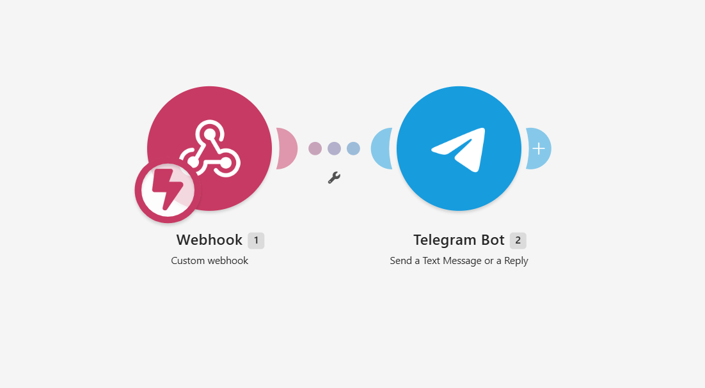

# Nombre del proyecto
Oferta y demanda de camarón

## Descripción
El proyecto usa Arduino para simular cómo cambia el precio de equilibrio del camarón al variar la oferta y la demanda. La placa lee dos entradas analógicas y muestra el precio calculado en su matriz LED.

Cuando el índice de demanda supera al de oferta por al menos 25 puntos, el sketch puede iniciar una alerta. El escenario de Make está diseñado para recibir los datos mediante un webhook y enviar un mensaje a Telegram.

## Objetivos de aprendizaje
- Explicar cómo cambia el precio de equilibrio cuando varía la oferta o la demanda.
- Simular variaciones de oferta y demanda con entradas analógicas en Arduino.
- Mostrar el precio calculado en una matriz LED y consultar las lecturas en el monitor serie.
- Integrar una alerta de escasez con un webhook de Make y un bot de Telegram.
- Distinguir los valores simulados de los datos del mercado de camarón.

## Material utilizado
- Arduino UNO R4 WiFi con matriz LED integrada.
- Dos entradas analógicas para controlar la demanda (A0) y la oferta (A1).
- Arduino IDE y las bibliotecas `WiFiS3`, `ArduinoGraphics` y `Arduino_LED_Matrix`.
- Red Wi-Fi con acceso a internet.
- Make con un webhook personalizado y un bot de Telegram conectado al chat de destino.

## Diagrama del flujo
Arduino convierte ambas lecturas a índices de 10 a 90, calcula el precio y lo muestra en la matriz LED. Al entrar en escasez y si se cumple el intervalo de espera, el sketch intenta enviar los valores a Make. El escenario los usa para componer el mensaje de Telegram.

Entradas A0 y A1 → Arduino → Cálculo del precio y detección de escasez → Webhook de Make → Bot de Telegram.

## Código
- [Sketch de Arduino](c%C3%B3digo/Oferta_y_demanda/Oferta_y_demanda.ino)
- [Blueprint del escenario de Make](c%C3%B3digo/Oferta%20y%20demanda.blueprint.json)

Para utilizar el proyecto:

1. Abre `Oferta_y_demanda.ino` en Arduino IDE y selecciona la placa Arduino UNO R4 WiFi.
2. Conecta las señales de demanda a A0 y de oferta a A1. Ajusta `RED_WIFI` a la red que utilizarás.
3. Carga el sketch, varía las dos entradas y observa el precio en la matriz LED. El monitor serie a 9600 baudios muestra la demanda, la oferta y el precio.
4. Para probar la alerta, espera más de 60 segundos desde el arranque o el último intento y haz que la diferencia pase de menos de 25 a 25 puntos o más.

Para reproducir el envío a Telegram, importa el blueprint en Make, configura tu webhook, conecta tu bot al chat de destino y activa el escenario. En el sketch, ajusta `HOST_MAKE` y `RUTA_MAKE` a tu webhook e incluye la barra inicial en la ruta. En el mensaje de Make, asigna los campos `oferta` y `precio` del webhook a sus valores correspondientes. El sketch actual no comprueba la respuesta HTTP, así que confirma la entrega en el chat.

## Video del funcionamiento

[Ver en YouTube](https://youtu.be/QpLL3Y6ZHgE) · [Video sin audio en el repositorio](video/Oferta_y_demanda_sin_audio.mp4)

## Imágenes
Captura de la integración entre Make y Telegram:

## Conclusiones
Con la demanda fija en 60, el modelo arroja un precio de $320 si la oferta es 50 y de $360 si baja a 30. Son valores simulados. El ejemplo permite observar cómo la menor disponibilidad eleva el precio calculado.

Una alerta automática puede ayudar a una cooperativa a revisar inventarios y coordinar entregas. Para usarla en una operación real, los umbrales deben basarse en datos de pedidos e inventario, y la entrega de la alerta debe confirmarse en Telegram.

## Resultados

[Resumen técnico y respuestas a las cinco preguntas (PDF)](resultados/Resumen_tecnico_oferta_y_demanda.pdf)
